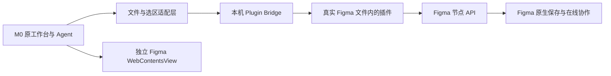

# Astrix 与 M0 的 Figma 接入对照

核对日期：2026-10-23。Astrix 按 GitHub 实时返回的默认分支 `main`、提交 `8da3e5b6bf8b3981f50a5e22b26d9484846795bf` 检查。网页搜索缓存仍出现旧分支名，本报告以当前源码为准。本轮是源码联合核对，现有 M0 0.5.0 应用未改动、未重新打包。

## 结论

Astrix 实现的路线正适合本项目：**加载真正的 Figma 编辑器，让 Figma 自己提供画布、矢量、原型和在线多人协作，再通过插件把 Agent 接进去。** 无需先复原历史 Figma 的完整 HTML、WASM 与云服务，也无需逐项重做 Figma 的编辑器功能。

原 M0 也加载真实 Figma 页面，但使用了内部静态代理和注入接口。前期“缺少历史运行时，无法离线启动原引擎”的判断，只适用于离线复原旧构建，不能扩大为“无法接入在线真实 Figma”。目前本地画布是另一种实现，不等于直接打开原 Figma 编辑器。

## 源码证据

| 对象 | 实际行为 | 位置 |
| --- | --- | --- |
| Astrix 真编辑器 | `makeFigmaView()` 创建 `WebContentsView`，直接 `loadURL(tab.url)`；没有给真实 Figma 页面添加桌面 preload | [客户端/desktop/main.ts:864](https://github.com/jinny-wj/astrix-agent/blob/8da3e5b6bf8b3981f50a5e22b26d9484846795bf/客户端/desktop/main.ts#L864) |
| Astrix 登录隔离 | Figma 使用独立持久 session，关闭 Node 集成，开启 context isolation、sandbox 和 web security | [main.ts:42](https://github.com/jinny-wj/astrix-agent/blob/8da3e5b6bf8b3981f50a5e22b26d9484846795bf/客户端/desktop/main.ts#L42) |
| Astrix 工作区上下文 | 从当前标签 URL 取得文件键和 node-id；这一步不是实时读取 Figma 选区 | [main.ts:398](https://github.com/jinny-wj/astrix-agent/blob/8da3e5b6bf8b3981f50a5e22b26d9484846795bf/客户端/desktop/main.ts#L398) |
| Astrix 实时选区 | 目标文件内的插件上报文件、会话、页面、选区版本与图层信息 | [figma-plugin-bridge/code.js:194](https://github.com/jinny-wj/astrix-agent/blob/8da3e5b6bf8b3981f50a5e22b26d9484846795bf/客户端/figma-plugin-bridge/code.js#L194) |
| Astrix 实写 | 本地队列 → 插件 UI 轮询 → 插件线程执行 Plugin API → ack → 前端查询结果 | [ui.html:99](https://github.com/jinny-wj/astrix-agent/blob/8da3e5b6bf8b3981f50a5e22b26d9484846795bf/客户端/figma-plugin-bridge/ui.html#L99)、[code.js:1033](https://github.com/jinny-wj/astrix-agent/blob/8da3e5b6bf8b3981f50a5e22b26d9484846795bf/客户端/figma-plugin-bridge/code.js#L1033) |
| 原 M0 | `FigmaManager` 的 `proxyFigma/hijackFigma` 分支，真实页面、静态代理、功能桥注入 | [原恢复分析](rea-figma-findings.md)、`../M0-AI-recovered/extracted/app/out/main/index.js:7548/8355/8514/8679` |
| 本地 M0 | 准备脚本将原设计宿主强制换成 `/local-canvas/index.html`；`figma.isLoggedIn` 固定 false | `frontend-tools/prepare-frontend.mjs:102`、`server/m0-api.mjs:278` |

## 应怎样结合

1. **替换设计宿主。** 在 M0 桌面里增加独立 Figma `WebContentsView`，放在当前 Design 面板区域，提供打开文件链接、正常登录、加载错误与页面切换状态。继续使用恢复出的原 M0 外层界面及原 KSCode；Astrix 的整套 React 界面无需整体替换 M0。
2. **隔离真实网站。** Figma 使用自己的 session；M0 工作台现有的请求本地化和网络限制继续服务于工作台。`frontend-tools/local-runtime.js` 的 fetch/XHR/WebSocket 重写不能注入 Figma 页面，真实网站也不能拿到本地桌面/终端 IPC。
3. **接入插件协议。** 使用 Astrix 的选区快照、命令、结果关联思路，统一目标文件、插件会话、节点列表与选区版本。现 M0 服务为 4317，Astrix 插件、服务、Origin 与 manifest 使用 5273，须整体对齐。
4. **适配 M0 接口。** 先接当前文件与选区、查询节点、改文本/颜色/位置/尺寸、创建 Frame/Text、真实导出，再逐项映射已有 M0 工具。适配的是 Agent 操作协议，原生图层树、矢量工具和多人编辑交给 Figma。
5. **接回生成器。** 插件从真实文件导出节点与素材，转换为当前 KRN 需要的 M0Schema，再调用已接通的原 KRN 转换器。原桥已使用标准 `exportAsync({format:'JSON_REST_V1'})`，可以优先沿这条节点导出链适配；这是官方导出能力，不应一并误判为企业补丁。已有代码生成器无需重写。见 [官方 ExportSettings](https://developers.figma.com/docs/plugins/api/ExportSettings/)。

| M0 需求 | 可用基础 | 接入边界 |
| --- | --- | --- |
| 打开文件、原生矢量与多人协作 | 真 Figma 页面 | 依赖正常联网、账号及文件权限；不是本地离线引擎 |
| 当前文件/选区、基本属性修改 | Astrix Plugin Bridge | 实时选区须来自当前文件内运行的插件；URL node-id 不足以替代 |
| 元数据、选择节点、导出图片/SVG | 标准 Figma Plugin API | 可以适配，Astrix 现有协议并未覆盖原 M0 全部函数 |
| `m0.design.htmlRead/htmlWrite/htmlSync` | 已恢复的 M0 算法及标准节点 API | 需检查运行环境与数据结构，不能把原注入的 `window.figma` 直接等同于插件里的 `figma` |
| 企业资产、团队设计系统、发布与权限覆层 | 原 M0 服务或对应授权接口 | Astrix 不会自动补齐这些服务 |
| Code、终端、扩展、原 KRN | 当前 M0 已接通的组件 | 保留现有实现 |

## 真正运行还需要什么

编辑器页面登录、REST/OAuth 授权、Plugin Bridge 是不同环节。打开原生 Figma 页面使用正常网站登录；REST 用于读取资料；Agent 修改节点由插件在目标文件中执行，并返回执行结果。

Astrix 的“Bridge 安装”按钮实际是定位 manifest 文件，不会自动在 Figma 中安装插件。开发插件通过官方 Figma Desktop 导入；若要只在内嵌 Web 页面使用其现有协议，需要可在该页面运行的私有插件。当前协议依赖 `figma.fileKey` 私有能力，本地开发插件可启用，但不能把普通 Community 发布视为直接等价。见 [Astrix 插件说明](https://github.com/jinny-wj/astrix-agent/blob/8da3e5b6bf8b3981f50a5e22b26d9484846795bf/客户端/figma-plugin-bridge/README.md)、[官方 Manifest](https://developers.figma.com/docs/plugins/manifest/)、[官方 fileKey](https://developers.figma.com/docs/plugins/api/figma/)。

若插件运行在另一个 Figma Desktop 窗口，文件内容可通过 Figma 云同步，但两个编辑器实例的当前选区不能直接当成同一个选区。接入必须明确使用哪个文件、哪个插件会话的选区。

普通 File Embed/原型 iframe 也不能替代真实编辑器宿主和 Plugin API。官方 [Embed API](https://developers.figma.com/docs/embeds/embed-api/) 主要提供原型交互消息。

## 接入时必须补的协议约束

Astrix 的 `patch-nodes` 已有文件、会话、版本和目标校验，可作为可靠基础；旧 `/commands` 仍允许无会话命令，创建及旧写入分支未统一强制文件绑定，ack 也只按命令 ID 接收。合入 M0 前应统一这些约束、限定来源并关联执行者，避免多文件时误写或错误接受回执。批量操作的“atomic”实际采用预检与补偿回滚，须保留真实失败与回滚结果。

本次已核对宿主、插件、队列、回执和测试源码。仓库测试中的模拟 Figma 对象不能证明本机真实文件端到端已连通；后续验收应在专用测试文件中确认：原生手工编辑、选区上报、Agent 修改、插件回执、重新打开文件结果一致，以及切文件时旧命令被拒绝。
