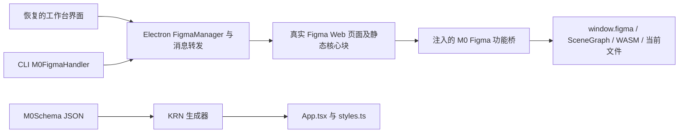

# M0 AI 设计引擎与插件代码的进一步恢复

本轮增加了 **475 份实际 JavaScript 文件，141,101,676 字节**。其中 5 份来自安装包/已恢复前端明确引用的 CDN 静态地址，470 份来自本机 FigmaProxy 专用缓存。两组均逐文件重新核对字节数与 SHA-256，**475 项全部通过，0 项失败**。

470 份 Figma 核心脚本作为独立代码证据保存，没有直接混装加载到本地工作台。5 份 CDN 代码中的生产 KRN/主题插件已按固定哈希创建隔离副本并实际接回。设计入口现在使用明确标注的独立本地画布，文件生成复用原 KRN 算法；不宣称原 Figma 云编辑器已离线启动。REA 程序本身的运行结果由主流程另行记录，不能把普通静态恢复表述成 REA 已验证了原产品的所有运行能力。

## 一、本轮真实取得的内容

| 来源 | 新文件 | 字节数 | 保存位置 |
| --- | ---: | ---: | --- |
| 精确引用的 CDN 静态 JavaScript，无认证普通 GET | 5 | 28,826,406 | [additional-static 清单](/Users/zhangye/Desktop/ceshi/M0-AI-recovered/web-assets/additional-static/manifest.json) |
| 本机 FigmaProxy 缓存，静态脚本 URL 与缓存键相互验证 | 470 | 112,275,270 | [figma-proxy-static-unique 清单](/Users/zhangye/Desktop/ceshi/M0-AI-recovered/web-assets/figma-proxy-static-unique/manifest.json) |

CDN 文件包括：

| 明确引用的资源 | 实际内容 | 字节数 | SHA-256 |
| --- | --- | ---: | --- |
| `app-figma-api/index.iife-76.js` | Figma 页内功能桥、HTML 转设计节点、设计覆层与权限接口 | 1,281,292 | `c2e63925e7c55b1e232ba4bb4ad14bd9cc390ba13e2654a5983fcd55da954a61` |
| 生产 `m0-plugin-files/id_1/plugin.js` | KRN 代码生成器、编译依赖及预览客户端 | 13,772,176 | `96c5032ee091b4ca488b421fdfbdc9670f84dc96e4a26500c37fb1920f427768` |
| 测试 `m0-plugin-files/id_25/plugin.js` | 测试版本 KRN 生成器 | 13,769,479 | `08e882cac942ff2d1596bc374cd2a043c4019dc363a61b4b5943fe019a2ecec7` |
| 生产 `m0-plugin-files/id_4/plugin.js` | 主题变量导出插件 | 1,806 | `df2ec6602e00623d4b5951c55f51cfaeae7b684ef6027cce29873283ca26d840` |
| 测试 `m0-plugin-files/id_32/plugin.js` | 测试版本主题导出插件 | 1,653 | `169777b5bb8f0336060a88247ba8a42822d965a04fe34fab59e7132e1c36f164` |

CDN 来源的依据是原生包 `FigmaManager` 的默认注入地址，以及已恢复前端中的 `BlobCDNHost`、`DEFAULT_PLUGIN_ID`、`loadRemotePlugin()`。没有通过猜测编号枚举插件。请求没有 Cookie、Authorization 或原始嵌入凭据，且没有跟随重定向。[精确地址恢复脚本](/Users/zhangye/Desktop/ceshi/m0-local/frontend-tools/probe-original-static.mjs) 与 [复核结果](/Users/zhangye/Desktop/ceshi/M0-AI-recovered/web-assets/additional-static/verification.json) 均已保存。

## 二、本机缓存为何能补回更多代码

原生代码的 `ProxyManager` 明确把缓存放在 `app.getPath("userData")/figma-cache`：[main/index.js:7370](/Users/zhangye/Desktop/ceshi/M0-AI-recovered/extracted/app/out/main/index.js:7370)。这与之前恢复的 Chromium `Cache/Cache_Data` 是两个目录。

缓存 JSON 仅保存 `content` 的 Base64、响应头和时间；它没有直接保存 URL。原生 `getCacheKey()` 则使用 `MD5(url + "#replaceRules=" + rulesHash)`：[main/index.js:6806](/Users/zhangye/Desktop/ceshi/M0-AI-recovered/extracted/app/out/main/index.js:6806)。

恢复过程先只读 Chromium 条目的固定文件头和 URL 键，以及 FigmaProxy JSON 尾部的 MIME 字段。然后用静态 `.js`/`.min.js.br` URL 与原缓存键算法反算匹配，匹配成功且 MIME 为 JavaScript 后才读取脚本正文。470 份成功匹配的 URL 全部位于 `https://www.figma.com/webpack-artifacts/assets/`，均具有静态文件路径。

原目录总共 5,297 项，其中 3,297 项 MIME 为 JavaScript；本轮仅取回能证明静态 URL 的 470 项。其余 **2,827 项 MIME-JS 未解码或提取正文**；1,650 项 HTML、344 项纯文本及其他未知类型也未取回。没有复制响应头、会话、Cookie、账户页面或初始化状态。所有输出以脚本正文 SHA-256 命名，来源 URL、缓存文件名、匹配算法与字节数在清单中逐项记录。[恢复脚本](/Users/zhangye/Desktop/ceshi/M0-AI-recovered/tools/recover_figma_proxy_static.py)、[470 项验证结果](/Users/zhangye/Desktop/ceshi/M0-AI-recovered/web-assets/figma-proxy-static-unique/verification.json) 可复查。

新缓存中包含 `figma_app-559e194079469e19.min.js.br` 对应的 8.29 MB 脚本，以及两份约 14.55 MB / 14.77 MB 的大型核心块。核心块里确实可见 `TSSceneGraph`、`getActiveTSSceneGraph`、Plugin API 与 WebAssembly 加载逻辑；不是只有产品宣传页或图片。代码标记目录见 [bridge-marker-inventory.json](/Users/zhangye/Desktop/ceshi/M0-AI-recovered/web-assets/figma-proxy-static-unique/bridge-marker-inventory.json)。

这些历史缓存可能来自多个 Figma 构建版本；470 个成功恢复的静态块并不等于一个完整且版本一致的构建依赖图。当前按内容哈希与来源路径保存，没有把不同版本强行混装运行。

## 三、原产品的设计调用链

原生 `FigmaManager.init()` 有两条可切换分支：[main/index.js:7548](/Users/zhangye/Desktop/ceshi/M0-AI-recovered/extracted/app/out/main/index.js:7548)。默认的新分支为 `proxyFigma()`，旧分支为 `hijackFigma()` 加后台 Figma 窗口。

新分支加载真实 `www.figma.com` 页面，针对 Figma 的 `*.min.js` 资源接入本地代理；代理再请求内部 `figma-server.corp.kuaishou.com/api/figma/app?path=…&hash=…` 取得对应静态代码：[main/index.js:6989](/Users/zhangye/Desktop/ceshi/M0-AI-recovered/extracted/app/out/main/index.js:6989)、[main/index.js:8514](/Users/zhangye/Desktop/ceshi/M0-AI-recovered/extracted/app/out/main/index.js:8514)。新取回的 470 份代码就是该专用代理缓存中可以确认来源的静态脚本。

页面 DOM 就绪后，原生注入 `app-figma-api/index.iife-76.js`；注入 URL 也可由服务端配置按应用版本替换：[main/index.js:8679](/Users/zhangye/Desktop/ceshi/M0-AI-recovered/extracted/app/out/main/index.js:8679)。因此固定默认脚本不一定等于实际运行时所选脚本，不能混为同一个版本。

功能桥通过字符串 JSON 消息交互，消息类型包括 `m0-ready`、`m0-function-call`、`m0-api-call`、`m0-message`；请求和返回用 `messageId` 关联。函数调用的响应仍使用相同的 `m0-function-call` 类型。桥代码先 `await waitForWindowFigma()`，再调用注册的函数。这证明它依赖已经启动的 Figma 运行时，而不是独立创建一个本地 Figma 引擎。

## 四、已经恢复的具体 API 与算法

新取回的默认桥注册了 **45 个函数**。此前实际缓存中的 `figma-api-inside/index.iife.1789527401890.js` 则注册了 **73 个函数**，包含这 45 个函数，并增加 28 个接口。逐项名单已输出到 [rea-figma-api-map.json](/Users/zhangye/Desktop/ceshi/m0-local/docs/rea-figma-api-map.json)。

| 能力 | 已见的真实函数/入口 | 运行依赖 |
| --- | --- | --- |
| HTML 与设计节点互转 | `m0.design.htmlWrite`、`htmlRead`、`htmlDiff`、`htmlSync`、`htmlCapture`、`renderSchema`、`parseSchema` | 真实 `figma` 节点 API、字体、当前文件及页面状态 |
| 节点与元数据 | `getMetaData`、`m0.design.getMetadata`、`findNodes`、`readMeta`、`writeMeta`、`selectNode` | 节点树及当前文件访问 |
| 设计系统 | `searchDesignSystem`、`getDesignSystemLibraries`、`getDesignSystemComponentDetails`、`getDesignSystemLibraryComponents` | 组件库/文件服务及对应访问能力 |
| 设计权限与协作覆层 | `policyCheck`、`policyGet`、`policySet`、`permissionRequest`、`overlayEvent`、`authorshipStats/Heatmap/Export` | 桥消息通道与画布节点 |
| 草稿和素材 | `createDraftFile`、`copyFileToDraft`、`m0.assets.*`、`exportCurrentPageClipboardScenes`、`pasteClipboardScenes` | Figma 文件 API 或页内运行时 |
| 视频与选区 | `exportVideoReference`、`injectVideoFill`、`m0.overlay.setAgentSelectionMode`、`finishVideoGeneration` | Figma 节点图片/视频填充能力 |
| 本地文件结果回传 | `sandbox.localFileResult`、`sandbox.localImageResult` | 明确的本地文件 RPC 适配器 |

CLI 侧也恢复了真实的工具映射和权限判断：[m0-figma.handler.ts:5](/Users/zhangye/Desktop/ceshi/M0-AI-recovered/extracted/app/node_modules/@m0/cli/src/server/modules/tools/handlers/m0-figma.handler.ts:5)。例如 `html_write` 映射到 `m0.design.htmlWrite`，`html_read` 映射到 `m0.design.htmlRead`；写操作先执行 `m0.design.policyCheck`，然后经 `ctx.callExecutor()` 转发。

KRN 插件并非空壳。生产插件第 284,457 行的 `toDSLWithSchema(schema)` 读取 `schema.nodeTree`，执行 `transformM0Node()` 与 `generateKRN()`，实际返回 `App.tsx` 和 `styles.ts`：[plugin.js:284457](/Users/zhangye/Desktop/ceshi/M0-AI-recovered/web-assets/additional-static/bs3-hb1.corp.kuaishou.com/upload-lux-portal/m0-plugin-files/id_1/plugin.js:284457)。它包含 `@kds/m0-plugins-core`、`@kds/m0-plugins-transform-krn` 的打包逻辑及 Babel、Prettier 等依赖。默认导出为 `{toDSLWithSchema, transformConfig}`。

该插件也在模块顶层初始化 Snack 并调用 `snack.setOnline(true)`：[plugin.js:284376](/Users/zhangye/Desktop/ceshi/M0-AI-recovered/web-assets/additional-static/bs3-hb1.corp.kuaishou.com/upload-lux-portal/m0-plugin-files/id_1/plugin.js:284376)。其梯度转换会访问 `window.m0.tools.gradients2RNStyle()`，预览会访问 `window.m0.codegenPluginEvent` 和企业 Snack 服务。原文件没有直接导入工作台；后续适配已隔离 Snack 初始化和预览事件，在独立工作线程中执行保留的原转换链，并接入原纯渐变函数。确切适配和输入/输出哈希记录于 [manifest.json](/Users/zhangye/Desktop/ceshi/m0-local/plugins/recovered/manifest.json)。

主题插件真实返回 `styles.json`、`variables.json`、`variable-collection.json` 三个文件。如果输入包含 `imageNodes`，还需要 `window.m0.exportAssetBatch()` 导出图片；没有图片节点时，JSON 导出部分可独立适配。

## 五、仍缺少什么，以及哪些边界已被实证

- 原工作台引用的 `/left-iframe.html` 与 `/nest-canvas.html` 直接无认证 GET 均返回 **HTTP 302**。没有跟随跳转或读取认证页面正文。这两个原始 HTML 运行入口仍未取得。
- 本轮 470 份是哈希化静态 JS，不包含 Figma 编辑器所需的完整 HTML/bootstrap 状态、当前文件、用户权限与协同服务。核心脚本还引用 `compiled_wasm.wasm`、`fullscreen.wasm`、`jsvm-cpp.wasm` 等文件名；本轮仅盘点这些静态引用，**没有取得对应 WASM 正文，也没有据文件名猜测下载地址**。
- 注入桥用到真实 `figma.createFrame/createText/createImage`、节点查询、字体加载、变量与 viewport 等接口。恢复桥源码可以解释这些能力如何编排，但不能只靠一个同名空对象实现原产品相同行为。
- 当前静态证据不能确认原画布是 Flutter。工作台与原生包没有 `main.dart`/CanvasKit 的明确部署入口；新 Figma 核心块中的 `Flutter` 出现在代码语言选项列表中，不能把这个词当作 Flutter 引擎证据。
- 服务端接口实现、账户权限、远端设计文件和模型后端没有因取回静态 JS 而自动恢复。此处没有破解登录、复制旧会话或使用安装包内原有凭据。

## 六、已经接回与后续可继续补回的能力

1. **已实现：离线 M0Schema → KRN 导出。** `plugins/local-generators.mjs` 调用隔离后的原 `toDSLWithSchema/transformM0Node/generateKRN`，真实生成 `App.tsx/styles.ts`，包含原线性渐变转换。`/codegen.html` 已接入 JSON 输入、源码查看、下载和导入当前工作区。没有替换为新写的简化代码生成器。
2. **已实现：原主题 JSON 导出。** 原 `generateThemeFile` 离线导出三类 JSON；图片导出保留明确错误，因为它需要真实 Figma 节点。浏览器实际操作已生成并导入两类结果共五个文件，落盘哈希记录在 [codegen-ui-verification.json](/Users/zhangye/Desktop/ceshi/m0-local/diagnostics/codegen-ui-verification.json)。
3. **有边界的 Figma 桥适配。** 已有 73 个确切接口名与消息格式，可据此建立能力表、请求关联和超时错误。只开放本地确实实现或用户正常授权连接后可用的接口，不能把 73 个接口全部返回成功来伪装画布已经恢复。

当前项目和聊天界面保留已验证的本地流程。桌面 Code 中央区域为原 KSCode 的 native host，浏览器使用本地文件编辑器；HTML 预览与原生成器另行接入。Design 入口已接入新写的本地设计画布：支持基本图形/文字、图层树、拖动/调整尺寸、属性、撤销/重做、项目级 canvas.json 保存、Figma REST/M0Schema 导入和 SVG/M0Schema 导出。真实 UI 验证覆盖编辑、重载、项目隔离、导入/下载，以及画布经原 KRN 生成源码后写入对应项目：[验证记录](/Users/zhangye/Desktop/ceshi/m0-local/diagnostics/canvas-ui-verification.json)。完整原 Figma 初始化仍未启用，没有把尚缺 bootstrap/WASM 的 470 份代码直接加载到用户工作台。
