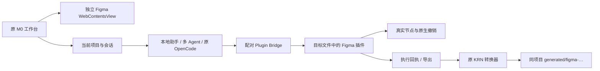

# 0.6.0：真实 Figma 与 Plugin Bridge

Design 默认入口现在打开官方 Figma 页面。原工作台、项目与会话、聊天、恢复的 OpenCode / 多 Agent、KSCode 编辑器、终端和扩展市场继续使用。旧独立画布和已有 `canvas.json` 数据保留，新增工作不再重写画布。

## 接入链路

Figma 自身负责画布、矢量和云端协作。新的宿主不注入原客户端 preload；远端页面没有本机 Node 或主窗口 IPC。登录会话独立持久化。Figma/Code 原生容器互斥，弹窗暂时隐藏远端页面；关窗保留真实 beforeunload 选择。

插件使用五分钟、一次性的本机配对码。命令绑定项目目录、真实文件、插件会话、选区版本和目标节点；只有实际执行回执可以报告成功。超时、撤销和取消不会变成成功回执。已经进入 Plugin API 的执行不保证能够中断，迟到结果独立记录。

Agent 具有读取、导出、创建 Frame/Text 和受控属性修改工具。AI Figma 写入默认关闭，独立于文件写入；原 OpenCode 通过每次运行独立鉴权的 MCP 调用同一桥接工具。只读任务在工具列表和执行端同时拒写。同次任务跟随自身成功回执推进版本，用户切换选区仍使旧请求失效。引擎退出会取消其未派发命令。

导出 Schema 后可使用恢复的原 KRN 转换器。素材以实际 PNG 保存并检查哈希；复杂外观用真实 Figma 导出的图片保留，结果明确列出降级说明。它不是完整组件/约束的双向转换；生成的 React Native 代码需要目标工程依赖。

## 运行与安装

`npm run desktop:figma` 打开最近项目的 Design，`npm run desktop` 保持原启动入口。操作步骤见 [真实 Figma 接入指南](真实Figma接入.md)。插件目录由工作区的“插件目录”按钮打开；manifest 会按当前服务端口生成。

当前文件键协议使用开发或组织私有插件能力，不能把打开网页登录当作插件已经安装。Figma 对文件键与私有插件的规定见 [Plugin API](https://developers.figma.com/docs/plugins/api/figma/)，开发 manifest 与插件 ID 说明见 [官方 manifest 文档](https://developers.figma.com/docs/plugins/manifest/)。

## 已验证范围

- 完整 Node 回归：122 项通过，覆盖原项目、文件、会话、模型、恢复的 OpenCode、多 Agent、旧数据，以及新增桥接、生成器和 Agent 测试。之后新增的 manifest ID 保留用定向测试复验。
- 宿主策略与生命周期：17 项通过；原扩展市场与本地导航策略回归通过；原生成器验证通过。
- 独立桌面测试：16 项通过，包含实际官方登录页渲染、Node/preload 隔离、容器边界、弹窗隐藏/恢复、插件目录、选区上下文、两次连续修改、SVG 导出、原 KRN、原聊天、Code 互斥与真实 PTY 输出。
- 插件写入与导出使用真实插件代码/UI脚本，经真实 HTTP 队列与回执执行，但 Figma 节点由明确的 Plugin API VM fixture 提供。恢复的 OpenCode 通过真实 MCP 执行该链路已验证。
- 没有登录用户 Figma 账号，没有据此宣称用户云端文件读写、云端协作或实际外部模型完成端到端验收。后续需在正常登录后运行目标文件插件配对。

诊断：`diagnostics/figma-all-node-tests.log`、`figma-final-targeted.log`、`figma-host-policy.log`、`real-figma-integration.json`、`figma-release-summary.json`。独立验收数据与正常用户项目分开。

## 数据与来源

升级前备份为 `.local-data/backups/state-before-0.6.0.json`。升级后核对原项目 ID/名称/目录、会话 ID 和历史消息数一致；模型仍是用户选择的演示模式。结果见 `diagnostics/upgrade-0.6.0-after.json`。

保留 `M0-AI-recovered` 原始恢复证据。宿主方法参考 Astrix 固定提交，插件派生来源、Git blob 与改动记录见 [SOURCES.json](../../../网页端/workbench/figma-plugin-bridge/SOURCES.json)。这不是完整原 M0 服务端、企业 Figma 私有 runtime 或云端资产服务的恢复，不能宣称二进制完全一致。
